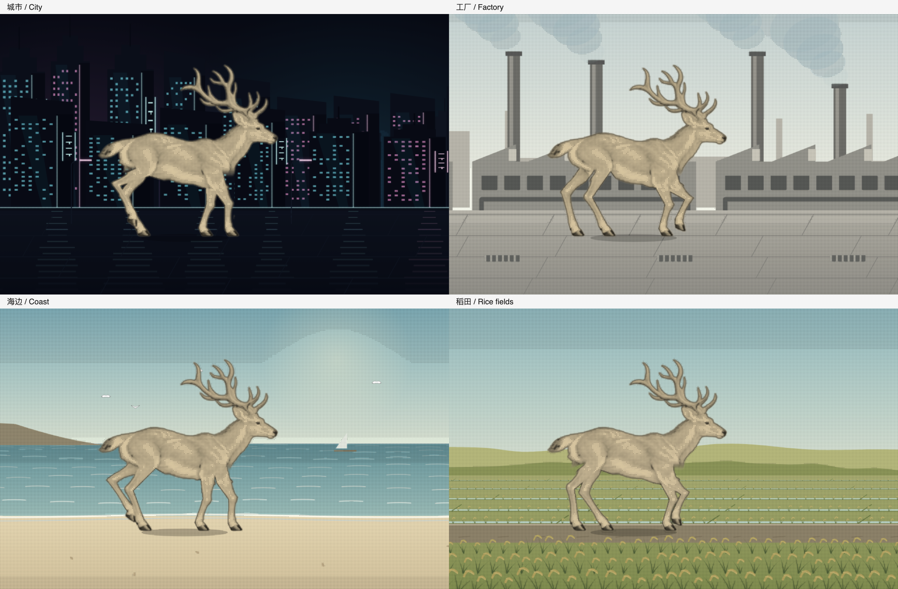

# 城市、工厂、海边与稻田

2026-11-05。首页增加四处风景，原有的鹿图集、步态和点击上色继续使用。

| 场景 | 画面 | 点击环境 |
| --- | --- | --- |
| 城市 | 暗色摩天楼、霓虹招牌、发光窗格、灯带与湿地倒影 | 从点击处亮起并扫动的灯光 |
| 工厂 | 锯齿屋顶、烟囱、飘动蒸汽、厂房窗列、外露管道 | 蒸汽 |
| 海边 | 海平线、远岬、帆船、白色海鸥、浪纹和干燥沙滩 | 白色海鸥群 |
| 稻田 | 远丘、水田、田埂、随风摆动和低垂的稻穗 | 阵风 |

默认仍是黑白网点，点击鹿后上色。全部场景共用几何与活动时钟，彩色状态增加颜料绘制；没有新增场景图片下载或重新烘焙鹿。新增场景见 `apps/website/scripts/meadow/scenery-places.js`。

顺序：草地 → 稻田 → 城市 → 工厂 → 海边 → 森林 → 雪山 → 夜景 → 沙漠。每处 8.4 秒，末尾 1.6 秒横向切换，全程 75.6 秒。减弱动态模式仍展示静止夜景，其时间从场景列表计算。

直接预览：本地首页加 `?t=18&play` 从城市播放，`?t=27&play` 从工厂播放，`?t=35&play` 从海边播放，`?t=10&play` 从稻田播放。去掉 `&play` 可固定画面，点击鹿或按回车切换上色。

[四个新场景，正常速度 60fps](new-scenes-60fps.mp4)：16 秒，每处截取 4 秒展示黑白及上色。此视频为预览节选，首页按完整时长连续切换。

## 验证

- 构建及 63 项 Node 检查通过，覆盖九个场景的时间边界、各场景点击分流、上色期间鹿姿态连续、减弱动态和键盘交互。
- 实际 Chrome 检查了全部九个切换的前、中、后及下一场景首帧，包含末尾返回草地；未出现画布缺口或运行异常。
- 1280×800、本机 Chrome、浅色主题：四处黑白和上色均约 60fps。绘制耗时第 95 百分位在 5.0–8.1ms 之间。详细数据见 [browser-check.json](browser-check.json)。此为本机短时采样，不代表所有设备。
- 检查 390×844 的四处固定帧、键盘上色，减弱动态仍保持夜景且不启动动画循环。
- `desktop-*`、`phone-*` 为共享渲染器导出的黑白、彩色和深色主题预览；`browser-*` 为实际浏览器截图。

海边的浪花和稻田的前景都留在鹿的行走地面之外；新场景不增加蹄下尘土。

城市与海边的后续调整见 [夜城灯光与白色海鸥](night-coast/README.md)。
