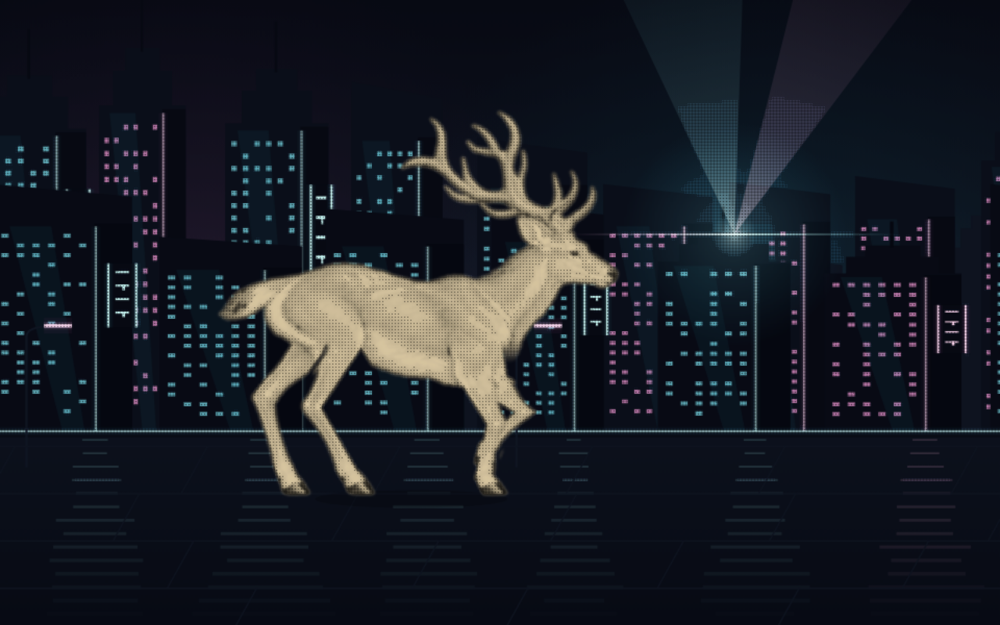
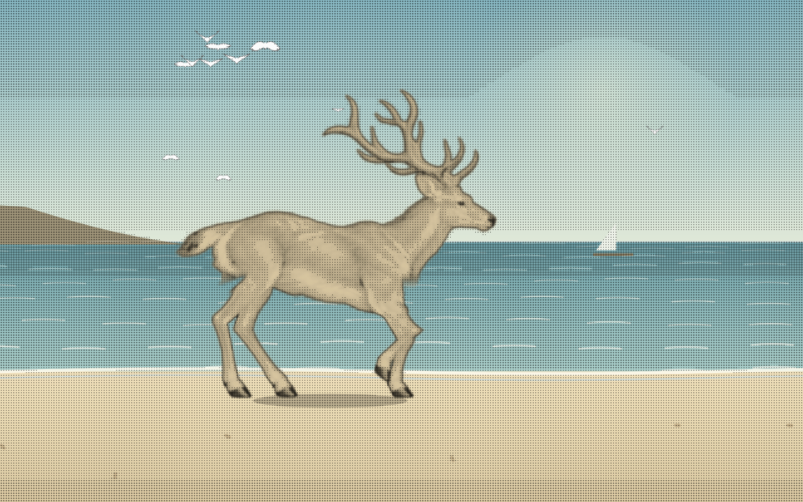

# 夜城灯光与白色海鸥

城市和海边不再共享飞鸟效果。城市改成赛博朋克夜景，海边使用白色海鸥。

- 城市：暗色楼群、发光窗格、霓虹招牌、灯带及断续的湿地倒影。黑白时仍能看出夜景，上色后灯带使用青色和紫红色。
- 城市点击：从点击处亮起光晕和两道缓慢扫动的光束，约 2.8 秒内淡出；上色状态下光束也使用霓虹色。效果不改变鹿的行走时钟。
- 海边：背景及点击产生的鸟统一使用白色填充翼面、灰色翼尖和细轮廓，保留缓慢振翅；两处共用 `gull.js` 中的形状。
- 点击鹿仍触发已有的整幅上色。手机、键盘和减弱动态行为沿用原有规则。

[正常速度互动预览](interactions.mp4)：12 秒，前半为城市，后半为海边，分别展示黑白和上色时的点击效果。

构建及 63 项 Node 检查通过。实际 Chrome 检查了全部九处切换、这两处的点击效果、手机固定帧的键盘上色及减弱动态模式，无运行时错误。1280×800 本机采样中，两处普通播放和上色叠加互动均约 60fps；城市互动绘制耗时第 95 百分位为 8.1ms，海边为 5.2ms。见 [browser-check.json](browser-check.json)。这是本机短时检查，不代表所有设备。

鹿的图集、骨骼和步态文件没有修改。
