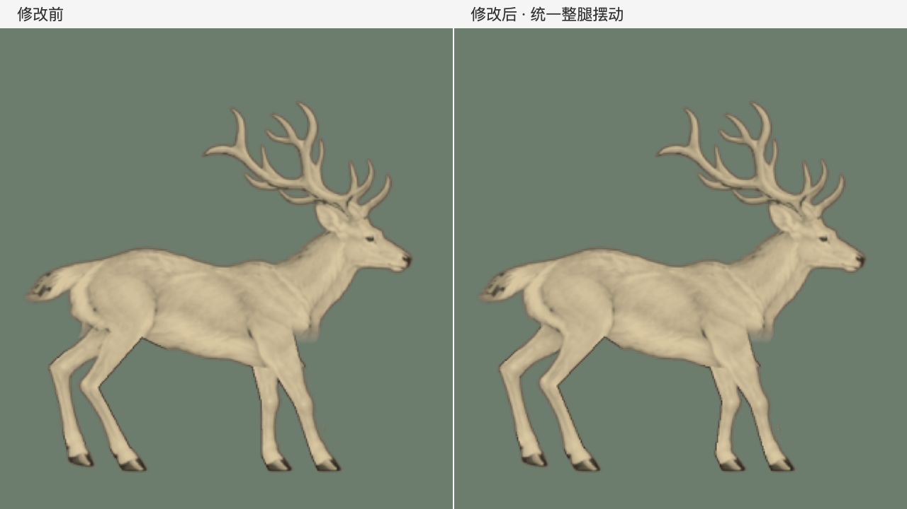

# 整条腿的摆动周期

2026-11-05，在上一版尚未提交的落脚时序修正上继续调整。

上一版只统一了蹄子轨迹。测量显示四蹄的水平轨迹在扣除相位差后完全重合，每条腿的完整周期均为约 1.333 秒；但后腿上段仍由原始图片的关节轨迹驱动，一步内有 6 次摆动方向变化，前腿旧求解方式也有 4 次。因此落脚间隔相同，整条腿仍会出现多余回摆，视觉上像步频不同。

本次移除行走模式中对原始关节曲线的独立重定时。肩、髋摆角由同一条蹄子前后运动轨迹驱动，再以固定骨长求解其余关节。四条腿均为每步一次前摆、一次后摆，共 2 次方向变化；扣除各自的落脚相位后，摆动转向时刻一致。前后腿保留各自的关节弯曲方向和摆幅，没有把四条腿改为同时抬落。

| 检查项 | 修改前 | 修改后 |
| --- | --- | --- |
| 每条腿完整周期 | 1.333 秒 | 1.333 秒 |
| 后腿上段每周期方向变化 | 6 次 | 2 次 |
| 前腿上段每周期方向变化 | 4 次 | 2 次 |
| 蹄子着地速度、落脚顺序 | 已统一 | 保留 |
| 头颈与躯干核心运动 | 既有基线 | 全部 160 帧像素保护通过 |

测量见 `measurements.json`。方向变化计数用于发现本次多余回摆，不是所有动物动作的通用判据。

[60fps 对比视频](cadence-comparison-60fps.mp4)：左侧为上一版，右侧为本次修改。5.33 秒，四个完整循环，不叠加网点。

验证：构建、63 项 Node 测试和 17 项 Python 测试通过，包括整腿摆动次数、相位对齐后的蹄子轨迹一致、骨长、接地、循环、皮肤翻折和既有头身像素保护。Chrome 中的点击上色、褪色、键盘及减弱动态检查通过，无运行时异常，记录见 `browser-check.json`。页面仍用 160 帧素材连续采样。二维插画的体积与交叠表现仍不等同于真实动作捕捉。
