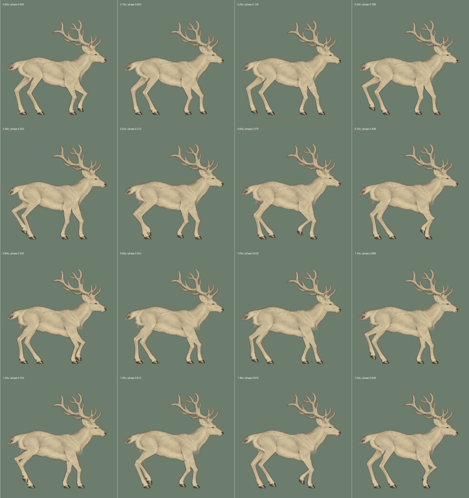

# 保留鹿形，移植参考中的行走节奏

2026-11-05。参考用户提供的 [Shutterstock 侧面行走动画](https://www.shutterstock.com/zh/video/clip-3978135683-deer-large-antlers-walking-gracefully-forest-clearing)，重做首页动作。

参考是绘制的循环动画。检查用户浏览器中实际播放的预览后，对右行片段按 0.1 秒间隔抽帧观察：相同姿态约 1.6 秒重复；后腿与对侧前腿有一段重叠的摆动，但落脚稍有先后。后蹄先在髋部后方抬起、收腿，随后向前送并伸展。接触时间是视觉区间估计，不能视为精确动捕；记录在 [reference-walk.json](../../art/milu/reference-walk.json)。

此前四条腿用相同的支撑比例和摆动曲线，落脚严格四等分，抬脚阶段偏短；前腿上段沿一条偏置较大的角度曲线运动，肩部容易停在后方，腕关节被迫折出尖角。

本次继续使用原来的鹿形、皮肤、关节长度和头颈躯干整体运动，调整迈步：

| 项目 | 修改前 | 本次 |
| --- | --- | --- |
| 完整左右步周期 | 约 1.333 秒 | 1.6 秒 |
| 落脚相位 | 0 / 0.25 / 0.5 / 0.75 | 0 / 0.15 / 0.5 / 0.65 |
| 后腿摆动时间 | 约 0.427 秒 | 0.72 秒 |
| 前腿摆动时间 | 约 0.427 秒 | 0.64 秒 |
| 前后腿路线 | 相同归一化轨迹 | 分别收腿、送出，仍共用周期与地面速度 |
| 前腿上段 | 沿旧肩部角度曲线摆动 | 由实际踝部位置和收腿程度求解 |
| 头、颈、躯干 | 一起起伏、俯仰 | 保留每个姿态的整体运动，随新周期一起放缓 |

为适应现有鹿的比例，步幅没有直接照搬参考；全程保留两蹄或三蹄支撑。收腿曲线在落地、离地处与地面速度连续，前后腿的骨长固定，近侧身体和两条腿仍是一张连续皮肤。参考视频的图像没有作为网页素材。

[正常速度前后对比，60fps](comparison-60fps.mp4)：左侧修改前，右侧本次。6.4 秒；右侧完成四个完整循环。两侧都按各自实际速度播放，不用慢放掩盖衔接。

[首页正常速度预览，60fps](homepage-walk-60fps.mp4)：直接使用首页渲染器，包含黑白、上色和恢复黑白。8 秒。

验证：构建及 63 项 Node 检查、17 项 Python 检查通过。包括骨长、循环接续、支撑蹄子的共同速度、640 个时刻的皮肤不翻折，以及全部 160 个姿态的头颈、躯干核心和尾巴像素与原基线一致。浏览器中点击、褪色、键盘和减弱动态检查通过，无运行时异常。1280×800 的本机 Chrome 测得黑白、上色均约 60fps，绘制耗时第 95 百分位分别约 7.4ms、7.5ms，见 [browser-check.json](browser-check.json)。运动数据见 [measurements.json](measurements.json)。

这仍是原插画的二维骨骼变形；测试验证连续性和回归，动作的观感需结合正常速度预览判断。
