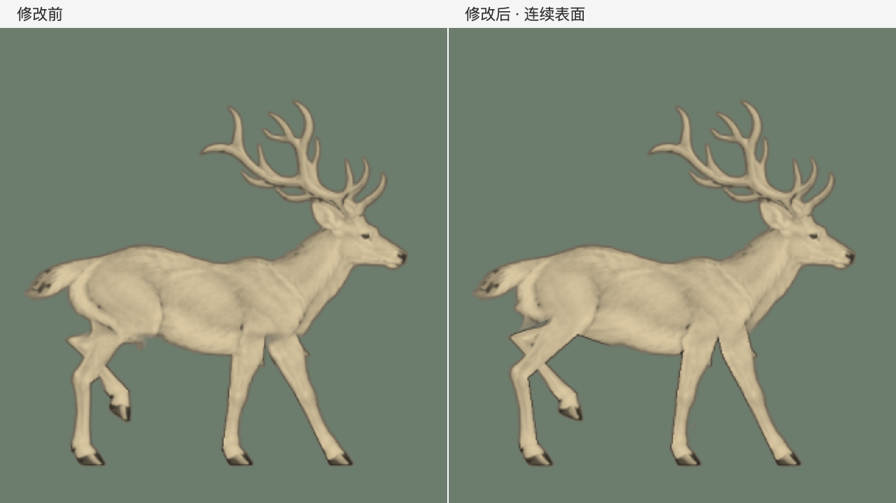

# 连续皮肤与关节修正

2026-11-04，在 `codex/refine-homepage-deer` 分支修正。

## 问题

黑白与上色共用同一套图集，颜色只是让原有的切割更明显。此前的流程把四条腿从上身切开、分别变形，再把固定上身按水平边界盖回去：肩、髋附近的皮肤无法跟着上腿转动，淡出的两层叠加还会形成半透明接缝。后腿标记把胫骨中点当成关节，也导致骨段长度不合理。

## 修改

- 躯干与近侧前、后腿成为同一张连续表面，接合边共用纹理坐标，只采样一次；远侧腿从后方遮挡。
- 校准肩、髋的连接点，让肩部和臀部随迈步变形，移除水平切线及固定上身回贴。
- 修正后腿关节的语义与骨长，保持蹄子的原有落点轨迹和形状。
- 继续使用上一版头、颈、躯干共同起伏的运动，保留点击上色与场景交互。没有单独固定头部。

## 对比

[60fps 原始画面对比](skin-comparison-60fps.mp4)：左侧修改前，右侧修改后；共 320 帧、约 5.33 秒、四个完整左右步循环。只显示带色的原始鹿素材，不叠网点或场景，避免遮住连接处。

`before-*.png` 和 `candidate-*.png` 是相同时刻的森林场景，candidate 对应已接入首页的最终素材。`browser-color.png` 是实际浏览器上色截图。

## 验证

- `npm test`：构建和 60 项测试通过。
- 离线 Python 测试：12 项通过，包括 640 个时刻的近侧表面无翻折、接缝无透明孔洞、骨长不变、循环连续和蹄子不穿地。
- 全部 160 帧的头颈、躯干核心、背部及尾巴保护区域与本次修改前逐像素一致。基线记录于 `art/milu/motion-core-lock.json`，来自修改前素材；肩、髋及下腹保留必要的形变空间。
- 实际 Chrome 验证点击鹿上色、自动恢复黑白、键盘操作和减弱动态效果通过，无运行时异常。具体记录见 `browser-check.json`；其中上色段包含截图与像素读取，不应当作独立的帧率基准。
- `git diff --check` 通过。

本次修正连接和形变方式，仍然是四个原始关键姿态驱动的二维插画，并非动作捕捉。关节轮廓仍有插画式的棱角，局部蹄子滑动和深度方向的旋转还不能由这些测试排除。自然程度需要结合正常速度的完整步态判断。
