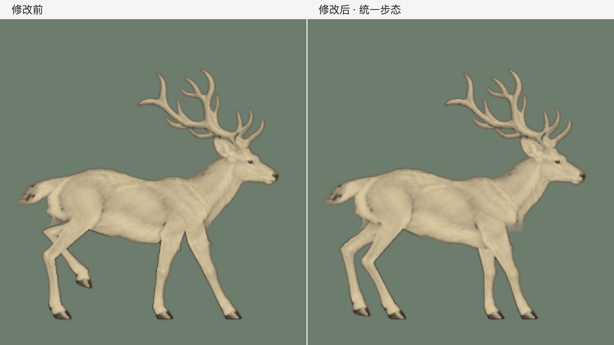

# 前后腿协调与落脚时序

2026-11-05。修改前基线为 `f8e8c00`，本次在 `main` 工作区调整，尚未提交。

## Review 发现

1. **着地蹄子没有共同速度。** 原先把四张生成图的每个坐标分别插值，导致支撑阶段的前蹄有时接近停住，有时突然后滑。前腿着地速度的第 5／50／95 百分位约为 7.52／100.85／509.42 工作像素每秒，后腿是 57.97／85.08／429.25。一个地面速度无法同时匹配这些轨迹。
2. **前后腿的交接时序不协调。** 近后腿在循环起点落地，同侧前腿却在 62.5% 时才落地。后腿只有约 50% 的支撑阶段，前腿约 62.5%，组合起来呈现前后各走各的感觉。四张姿态等间隔播放不能自动得到正确的四足步态。
3. **前腿骨段仍会伸缩。** 之前只给后腿和蹄子加了长度约束，前腿下段跟着插值坐标拉长、缩短。后腿最大抬高 52 工作像素，也让散步带有过度提腿的感觉。

## 本次调整

- `walk.py` 统一控制四条腿：近后 → 近前 → 远后 → 远前，每次落脚间隔四分之一个循环；每条腿 68% 时间支撑。任何时刻都有至少两条腿支撑，前后各有一条。
- 着地阶段统一以 90.44 工作像素／秒后移，网页地面使用相同速度，约 0.502 场景单位／秒。摆动曲线在抬脚和落地处匹配位置、速度和加速度。
- 后腿抬高从 52 收至 26，前腿从 36 收至 24；蹄子按同一摆动进度卷起、放平。原始关节参考平滑重定时，不再控制各自的落脚时刻。
- 前腿也固定骨长，支撑阶段接近伸直、摆动时屈曲。前后关节保持各自的弯曲方向，远腿不会因为参考图中的遮挡而成为另一种长度。
- 落脚粒子改用同一时序的四次接触，避免像素遮挡导致漏报或额外落脚。
- 继续使用原来的连续皮肤和头颈、身体统一运动；160 帧、0.75 循环／秒和页面 60fps 调度保持不变。

四拍关系参考 [Usherwood & Self Davies, 2017, eLife](https://elifesciences.org/articles/29495)：文中讨论同侧前后肢相位与支撑比例，25% 相位对应四次等距落脚。论文列出的白尾鹿样本支撑比例约 69%、相位约 31%，且样本较少。本次 68%／25% 是用于当前插画的试调参数，不声称复原了麋鹿的实测步态。

## 对比与验证

[正常速度前后对比](timing-comparison-60fps.mp4)：左侧修改前、右侧修改后，60fps、320 帧、四个完整循环；去掉网点和场景以直接检查动作。`before-*.png` 与 `candidate-*.png` 是相同时间的森林场景，后者对应已接入首页的版本。

- 网站构建及 63 项 Node 测试通过。
- 15 项 Python 测试通过：支撑速度一致、四拍接触、落地和离地速度连续、固定骨长、640 个时刻的表面无翻折，以及接缝无透明孔洞。
- 头颈、躯干核心、背部和尾巴保护区域在全部 160 帧里与既有基线逐像素一致；这段运动没有改为独立锁头。
- Chrome 实际检查点击上色、自动褪色、键盘和减弱动态效果通过，无运行时异常。普通播放采样约 60fps；上色采样包含截图和像素读取，不作独立性能基准。记录见 `browser-check.json`。
- 关节与接地测量见 `measurements.json`，速度单位是工作像素／秒，抬高单位是工作像素。
- `git diff --check` 通过。

这仍是二维插画驱动的动画。骨长和时序正确不等于真实动物动作已完全还原；深度方向的旋转、软组织体积及轮廓在交叠处的表现仍有限制。正常速度的完整步态是最终判断依据。
